# 多源新闻实时流处理与智能舆情分析平台 · 实验报告

> 项目名称：NewsPulse
> 代码位置：`D:\Dev\Github\news-pulse`
> 运行环境：Windows 11 · JDK 17.0.20 · Python 3.11.17 · Spark 4.2.0 · Kafka 3.9.0

---

## 一、项目背景与目标

### 1.1 背景

新闻信息呈现"多源、海量、高速"的特征：同一事件可能在数十个 RSS 源、社区论坛、社交平台同时出现，人工逐一浏览既不现实也无法及时。舆情感知（热点发现、情感倾向、来源分布）需要一条能持续消费、实时聚合、并能理解语义的处理链路。

传统做法是用定时脚本抓取后一次性处理，存在三个问题：抓取与处理耦合导致失败重试困难、无缓冲层无法应对突发流量、处理结果无法增量更新。

### 1.2 目标

构建一条端到端的数据管道，实现从采集、缓冲、流处理、存储、智能分析到可视化的闭环：

```
采集 → 消息队列缓冲 → 流处理清洗聚合 → 数据湖存储 → AI 语义分析 → 可视化
```

具体指标：

- 支持多源采集（RSS 与模拟数据双通道），单源失败不影响整体
- 使用 Kafka 作为缓冲层，topic 设置 3 个分区
- 使用 Spark Structured Streaming 完成清洗、去重与三类实时聚合
- 清洗结果与聚合结果落 Parquet 数据湖
- 用 Spark SQL 完成批处理热点识别与关键词趋势
- 调用大模型完成摘要、情感分类、实体抽取，具备缓存与重试
- Streamlit 看板展示趋势、情感分布、热点榜单与新闻列表

---

## 二、系统架构图及说明

### 2.1 架构图

```
┌──────────────────────────────────────────────────────────────────────────┐
│  数据采集层  producer/                                                    │
│  ┌──────────────┐   ┌──────────────┐                                     │
│  │ rss_fetcher  │   │   replay     │   并发抓取（全局 4 路 + 同域 2 路）   │
│  │ 真实 RSS 采集 │   │ 数据集重放   │   单源失败跳过，不中断整批            │
│  └──────┬───────┘   └──────┬───────┘                                     │
│         └──────────┬───────┘                                             │
│                    ▼  JSON (title/content/publish_time/source/url/lang)  │
│            kafka_producer.py  ──── 失败指数退避重试 ────                  │
└────────────────────┬─────────────────────────────────────────────────────┘
                     ▼
        ┌────────────────────────────────┐
        │  Kafka 3.9 (KRaft 单机)        │   topic: news.raw
        │  partitions = 3                │   key = URL hash（同 URL 落同分区）
        └────────────────┬───────────────┘
                         ▼
┌──────────────────────────────────────────────────────────────────────────┐
│  流处理层  streaming/spark_consumer.py                                    │
│                                                                          │
│   ① from_json 严格 Schema 解析                                           │
│   ② 清洗：剥 HTML、trim、时间多格式解析、URL 归一化                        │
│   ③ 去重：watermark(10min) + dropDuplicates(url_key)                     │
│   ④ 聚合：每分钟新闻量 / 各来源条数 / 关键词频率（过滤停用词）              │
│   ⑤ 输出：原始 → Parquet；聚合 → foreachBatch 落 Parquet + console        │
└───────────────┬──────────────────────────────────┬───────────────────────┘
                ▼                                  ▼
   ┌─────────────────────────┐     ┌──────────────────────────────────────┐
   │  数据湖 data/lake/      │     │  批处理层  batch/hotspot_job.py      │
   │  ├ news_raw/  (原始)    │────▶│  Spark SQL 读 Parquet                │
   │  ├ agg_minute/          │     │  · 热点：标题跨源重复度排序           │
   │  ├ agg_source/          │     │  · 趋势：关键词 Top 30                │
   │  └ agg_keyword/         │     │  结果 → SQLite (hotspots/trends)     │
   └───────────┬─────────────┘     └──────────────┬───────────────────────┘
               │                                  │
               ▼                                  │
   ┌─────────────────────────┐                    │
   │  AI 层  ai/             │                    │
   │  · client  客户端+重试   │                    │
   │  · cache   磁盘缓存      │                    │
   │  · tasks   摘要/情感/实体│                    │
   │  → ai_enriched/ Parquet │                    │
   └───────────┬─────────────┘                    │
               └──────────────┬───────────────────┘
                              ▼
┌──────────────────────────────────────────────────────────────────────────┐
│  可视化层  dashboard/app.py  (Streamlit + Plotly)                         │
│  KPI 卡片×5 · 新闻量趋势 · 情感环形图 · 来源分布 · 关键词 · 热点Top10      │
│  新闻卡片列表（含情感徽章与 AI 摘要）· 深浅色自适应                        │
└──────────────────────────────────────────────────────────────────────────┘
```

### 2.2 分层说明

| 层 | 职责 | 关键设计 |
|---|---|---|
| 采集层 | 从 RSS 或静态数据集生成标准化 JSON 事件 | 全局线程池 + 按域名信号量，防止单站限流；字段统一为 `NewsEvent` |
| 消息队列 | 解耦采集与处理，提供缓冲与重放能力 | 3 分区；以 URL 哈希作 key，保证同一新闻落同一分区 |
| 流处理层 | 清洗、去重、实时聚合、落湖 | `watermark` 支撑有状态去重；聚合用 `foreachBatch` 绕过 Parquet sink 的模式限制 |
| 数据湖 | 原始数据与聚合结果的列式存储 | 按用途分目录；Parquet 支持后续被 Spark SQL 直接查询 |
| 批处理层 | 定期做全局统计 | Spark SQL 直接读湖，结果写关系库供看板快速查询 |
| AI 层 | 语义理解 | 与流处理解耦的旁路批处理，避免 LLM 限流拖垮流式作业 |
| 可视化层 | 面向人的呈现 | pyarrow 直读 Parquet（毫秒级），不每次启 JVM |

### 2.3 数据流的关键设计：为什么 AI 不在流里

初始设想是在 Spark Streaming 的 `foreachBatch` 中直接调用大模型。实测发现两个问题：

1. LLM API 单次耗时 2-3 秒，远超微批间隔（5 秒），会积压
2. API 限流时重试会阻塞整个流，导致 Kafka 消费落后

因此改为**旁路批处理**：流处理只负责清洗与落湖，AI 层定期读取湖中未分析的记录做富化，结果写回独立的 `ai_enriched/` 目录。这样 LLM 故障只影响 AI 结果的产出速度，不影响数据管道本身。

---

## 三、技术选型理由

| 组件 | 选择 | 理由 |
|---|---|---|
| 消息队列 | **Apache Kafka 3.9（KRaft 模式）** | 作业要求 Kafka 或 Redpanda。选择 Kafka 的决定性原因是它提供官方 Windows 二进制与 `.bat` 脚本，且 KRaft 模式无需 ZooKeeper，单机启动只需一个进程。曾评估 Redpanda（单二进制、更轻量），但其 Windows 支持仅覆盖 `rpk` 客户端工具，broker 本身无原生 Windows 版本，在无 Docker 环境下不可行。 |
| 流处理 | **Spark Structured Streaming 4.2** | 作业指定。相比 DStream API，Structured Streaming 基于 DataFrame，天然支持 SQL、事件时间窗口与 watermark 语义，写 Parquet 与后续批处理查询共用同一套 API。 |
| 数据湖格式 | **Parquet** | 作业允许 Delta Lake 或 Parquet。Parquet 是 Delta 的底层格式，列式压缩率高、Spark 原生支持、无需额外依赖。当前场景无 ACID 事务与时间旅行需求，Parquet 足够。 |
| 聚合结果库 | **SQLite** | 聚合结果量级很小（百行级），SQLite 标准库即可，零安装、零运维。看板查询走 SQL 索引，响应在毫秒级。相比 ClickHouse/PostgreSQL 更适合单机演示场景，且迁移成本低——`storage/sink.py` 中已隔离数据访问层。 |
| AI 服务 | **DeepSeek（OpenAI 兼容协议）** | 通过 `openai` SDK 调用，换任何 OpenAI 兼容服务只需改 `base_url` 与 `model`，代码零改动。选择 DeepSeek 是因其中文理解质量好、价格低，适合批量情感与摘要任务。 |
| 可视化 | **Streamlit + Plotly** | Streamlit 用纯 Python 描述 UI，无需前后端分离；Plotly 支持交互式图表（悬浮提示、缩放、导出 PNG），比 Streamlit 内置图表更接近生产看板。 |
| 运行时 | **Python 3.11 + uv** | PySpark 4.x 官方支持到 3.12，本机系统 Python 为 3.14（不兼容）。用 `uv python install 3.11` 获取隔离的 3.11 环境，不影响系统 Python。 |

---

## 四、核心模块实现

### 4.1 数据采集模块（`producer/`）

**数据模型**（`schemas.py`）以 dataclass 定义，全链路共用：

```python
@dataclass
class NewsEvent:
    title: str
    content: str          # 截断至 2000 字
    publish_time: str     # ISO8601
    source: str
    url: str
    lang: str = "zh"
    event_id: str         # uuid4
    ingested_at: str      # 采集时间
```

`__post_init__` 统一做清洗与截断，`is_valid` 保证 title 与 url 非空——脏数据在进入管道前就被挡掉。

**并发采集**（`rss_fetcher.py`）采用两层限流：

```python
# 全局线程池限制总并发
with ThreadPoolExecutor(max_workers=workers) as pool:
    # 每个域名一个信号量，防止单站 429
    sema = limiter.get(host)
    with sema:
        feed = _download_feed(url, retries=2)
```

单源失败只记录日志并返回空列表，不中断整批。这是"每日无人值守运行"场景的必要设计——实测中 5 个源里总有 0-1 个临时失败。

**数据集重放**（`replay.py`）满足作业"若使用静态数据集需编写重放程序"的要求，按指定速率逐条发送到 Kafka，同时内置模拟数据生成器作为兜底，保证无网络时演示仍可执行。

### 4.2 流处理模块（`streaming/spark_consumer.py`）

五段流水线：

**① 解析** — 用显式 `StructType` 而非 `inferSchema`，避免流式场景下 Schema 推断失败。

**② 清洗** — 其中时间解析踩过坑（见第六节），最终实现为多格式兜底：

```python
.withColumn("_pt_nodow", regexp_replace(col("publish_time"), r"^[A-Za-z]{3},\s*", ""))
.withColumn("publish_ts", coalesce(
    to_timestamp(col("_pt_nodow"), "dd MMM yyyy HH:mm:ss Z"),
    to_timestamp(col("_pt_nodow"), "yyyy-MM-dd'T'HH:mm:ss.SSSSSSXXX"),
    to_timestamp(col("_pt_nodow")),
))
```

**③ 去重** — 用事件时间 watermark 支撑有状态去重：

```python
cleaned.withWatermark("ingested_ts", "10 minutes").dropDuplicates(["url_key"])
```

`url_key` 是 URL 归一化（去尾斜杠、转小写）后的结果，避免同一文章因 URL 差异被判为不同。

**④ 聚合** — 三类指标：

| 指标 | 实现 |
|---|---|
| 每分钟新闻量 | `groupBy(window("ingested_ts", "1 minute")).count()` |
| 各来源条数 | `groupBy("source").count()` |
| 关键词频率 | 标题切词后 `groupBy("word").count()`，并用 `isin` 下推停用词表 |

关键词处理特意用 `length(col) >= 2` 而非正则量词 `{2,}`，因为 Python 正则转 Java 正则时量词会触发解析异常。

**⑤ 输出** — 原始数据用 `writeStream.format("parquet")`；聚合结果因 Parquet sink 不支持 `complete`/`update` 模式，改用 `foreachBatch` 在微批内转静态 DataFrame 写入：

```python
per_minute.writeStream.outputMode("update").foreachBatch(
    lambda df, eid: write_agg_batch(df, eid, path)
).option("checkpointLocation", ckpt).start()
```

### 4.3 存储层（`storage/`）

| 数据 | 位置 | 格式 | 说明 |
|---|---|---|---|
| 清洗后原始新闻 | `data/lake/news_raw/` | Parquet | 流式 append，按批次分文件 |
| 三类实时聚合 | `data/lake/agg_*/` | Parquet | foreachBatch 落盘 |
| AI 富化结果 | `data/lake/ai_enriched/` | Parquet | 含 summary/sentiment/entities |
| 批处理聚合 | `news_pulse.db` | SQLite | `hotspots` / `trends` 两表 |
| AI 缓存 | `data/cache/ai_cache.jsonl` | JSONL | 追加写，重启不丢 |

`storage/spark_env.py` 集中处理 Windows 下的 Spark 环境问题（见第六节），被三个 Spark 模块共用。

### 4.4 AI 智能应用（`ai/`）

三个任务各自独立 prompt，输出格式强约束以便程序解析：

| 任务 | Prompt 要点 | 解析方式 |
|---|---|---|
| 摘要生成 | "用一句话概括，严格不超过 50 个汉字" | 硬截断 120 字兜底 |
| 情感分类 | "只能从 positive/negative/neutral 选一个，只输出标签" | 正则提取，无法匹配则抛异常 |
| 实体抽取 | "严格输出 JSON：`{persons,orgs,places}`，每类最多 5 个" | `json.loads` + 字段校验 |

**作业要求的三项机制：**

1. **缓存**（`cache.py`）— key 为 `sha256(task + "|" + text[:500])`，命中直接返回。实测命中耗时 <0.001s，未命中需 2.59s。
2. **批量**（`batch_runner.py`）— `--limit N` 控制批量，逐条处理。这里刻意**不用**"一次请求带 N 条"的方案：单条内容被安全策略拦截时，整批都会失败；逐条处理则只损失单条。
3. **重试**（`client.py`）— 3 次指数退避（2s/4s/8s），且把"响应结构异常"（如 `choices` 为 `None`）也纳入重试，而非让它直接崩溃。

### 4.5 批处理分析（`batch/hotspot_job.py`）

用 Spark SQL 读数据湖，热点识别逻辑是「同一标题在多源重复出现的次数」——这在新闻场景下是有效的热度信号（一个事件被越多家媒体报道越重要）。

```sql
SELECT ANY_VALUE(url) AS url, title, COUNT(*) AS mentions, MAX(...) AS score
FROM news GROUP BY title ORDER BY mentions DESC, score DESC LIMIT 20
```

结果写 SQLite 供看板快速查询。该作业可挂 cron/任务计划实现定期执行。

### 4.6 可视化看板（`dashboard/app.py`）

页面结构：

| 区块 | 图表类型 | 数据源 |
|---|---|---|
| 顶部 hero | 渐变横幅 | — |
| KPI 卡片 ×5 | 数字卡片 | 各湖表 + SQLite |
| 新闻量趋势 | Plotly 面积图（平滑曲线 + 渐变填充） | `agg_minute` |
| 情感分布 | Plotly 环形图（中心显示总数） | `ai_enriched` |
| 来源分布 | Plotly 横向条形图 | `agg_source` |
| 高频关键词 | Plotly 横向条形图（已过滤停用词） | `agg_keyword` |
| 热点 Top10 | 卡片列表（前三名彩色排名） | SQLite `hotspots` |
| 新闻列表 | 卡片列表（情感徽章 + AI 摘要） | `ai_enriched` |

**两个工程细节：**

1. **数据读取优先 pyarrow** — 看板每 5 秒刷新，若每次都构造 SparkSession 需等待 JVM 启动约 20 秒。改为 `pyarrow.parquet.read_table` 直读，耗时毫秒级，仅在 pyarrow 不可用时回退 Spark。
2. **深浅色自适应** — 图表颜色按 `_is_dark()` 检测结果设置；由于 Streamlit 切换主题不会重跑脚本，额外注入 JS 监听主题变化并自动刷新，避免切换后配色错乱。

---

## 五、运行结果

### 5.1 环境自检

```
🔎 环境自检
  JDK 17       : C:\Program Files\Eclipse Adoptium\jdk-17.0.20.101-hotspot
  Java 版本    : openjdk version "17.0.20.1" 2026-08-18
  Python       : Python 3.11.17
  Kafka 数据   : D:\Dev\Github\news-pulse\data\kafka
  已格式化     : 是
  DeepSeek Key : 已配置
  本地配置     : D:\Dev\Github\news-pulse\config.local.ps1
  ✅ 关键文件齐全
```

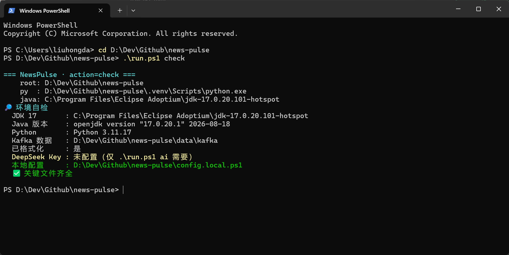

*图 5-1：`run.ps1 check` 环境自检输出*

### 5.2 Kafka 与 Topic

```
$ .\run.ps1 topic
创建 topic news.raw（3 分区）...
当前 topic:
   Topic: news.raw  TopicId: f-DvRTOJTk-YIgj5ZgDenw  PartitionCount: 3  ReplicationFactor: 1
   Topic: news.raw  Partition: 0  Leader: 1  Replicas: 1  Isr: 1
   Topic: news.raw  Partition: 1  Leader: 1  Replicas: 1  Isr: 1
   Topic: news.raw  Partition: 2  Leader: 1  Replicas: 1  Isr: 1
```

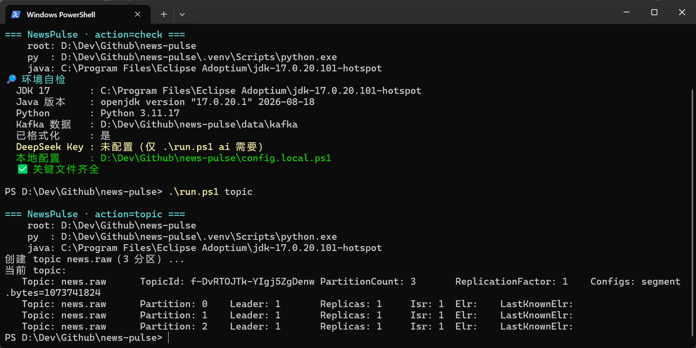

*图 5-2：topic `news.raw` 创建，PartitionCount = 3*

### 5.3 Producer 发送

```
$ .\run.ps1 produce
📡 抓取 5 个 RSS 源（并发 4，同站最多 2）
   ✓ TechCrunch       5 条
   ✓ Ars Technica     5 条
   ✓ BBC中文           5 条
   ✓ Solidot          5 条
   ✓ InfoQ 中国        5 条
✅ 共 25 条（去重后 25 条）
✅ 发送完成：25/25 条 → topic news.raw
```

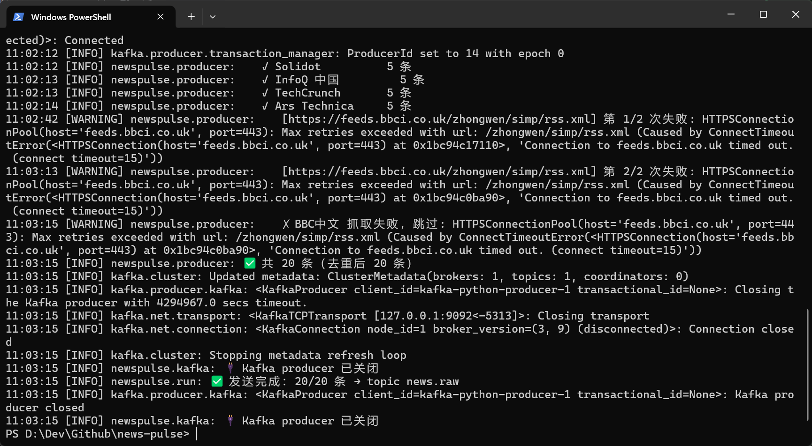

*图 5-3：5 个 RSS 源并发采集与 Kafka 发送*

### 5.4 Spark Streaming 消费

```
$ .\run.ps1 stream
🚀 流处理已启动，5 个查询
   Parquet → D:\Dev\Github\news-pulse\data\lake
Batch: 0
Batch: 1
Batch: 2
```

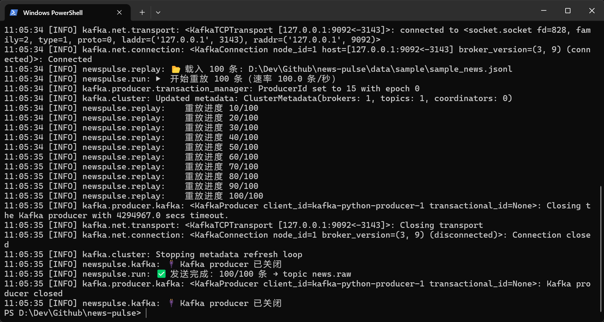

*图 5-4：Structured Streaming 微批处理，Batch 序号递进*

### 5.5 Parquet 数据湖产出

```
data/lake/
├── news_raw       22 个文件（25 行）
├── agg_minute     12 个文件（1 行）
├── agg_source     18 个文件（9 行）
├── agg_keyword    22 个文件（285 行）
└── ai_enriched    28 个文件（12 行）
```

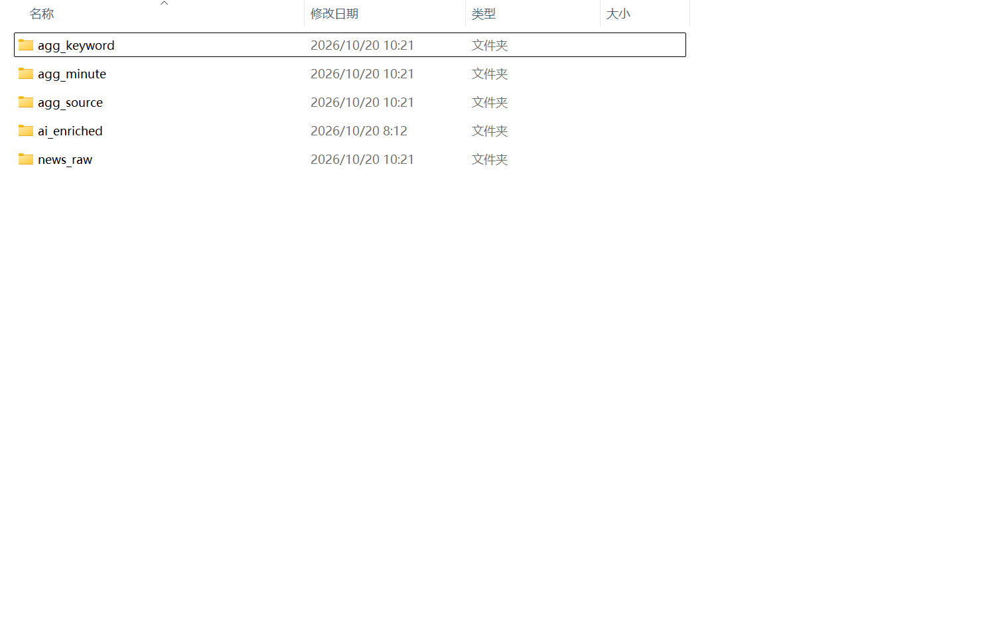

*图 5-5：Parquet 数据湖目录结构*

### 5.6 AI 分析结果

```
$ .\run.ps1 ai 12
💾 缓存已载入 0 条
🤖 待分析 12 条
   进度 5/12（ok=5 failed=0）
   进度 10/12（ok=10 failed=0）
   进度 12/12（ok=12 failed=0）
✅ 分析完成：ok=12 failed=0
```

产出样例：

| 标题 | 情感 | 抽取实体 |
|---|---|---|
| Accused OpenAI spy had folder called "Saudi Gov Docs," FBI says | negative | 人物：Abdulrahman Alfozan / Craig Missakian |
| Russian spacecraft maneuvers in "extreme proximity" to satellite | negative | 地点：low-Earth orbit |
| Pennsylvania issues alert on congenital measles | negative | 地点：Pennsylvania |
| 谷歌开源 Harness，支持 OpenCode 和 Codex | positive | — |

**缓存效果验证**：首次 API 调用耗时 2.59s，二次命中缓存 0.000006s，返回值完全一致。

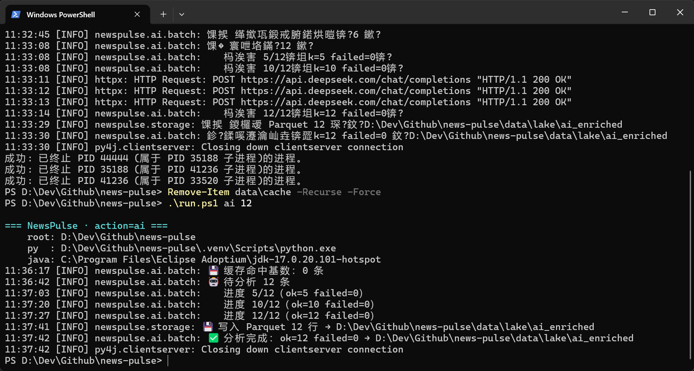

*图 5-6：AI 三任务批量分析（摘要 / 情感 / 实体）*

### 5.7 批处理热点分析

```
$ .\run.ps1 batch
💾 写入 SQLite hotspots 12 行
💾 写入 SQLite trends 30 行
✅ 批处理完成：热点 12 条，趋势词 30 个
```

SQLite 查询结果（关键词已过滤停用词）：

```
ai         -> 6      opencode  -> 2      tool      -> 2
reduce     -> 2      emissions -> 2      batteries -> 1
anthropic  -> 1      amazon    -> 1      codex     -> 1
```

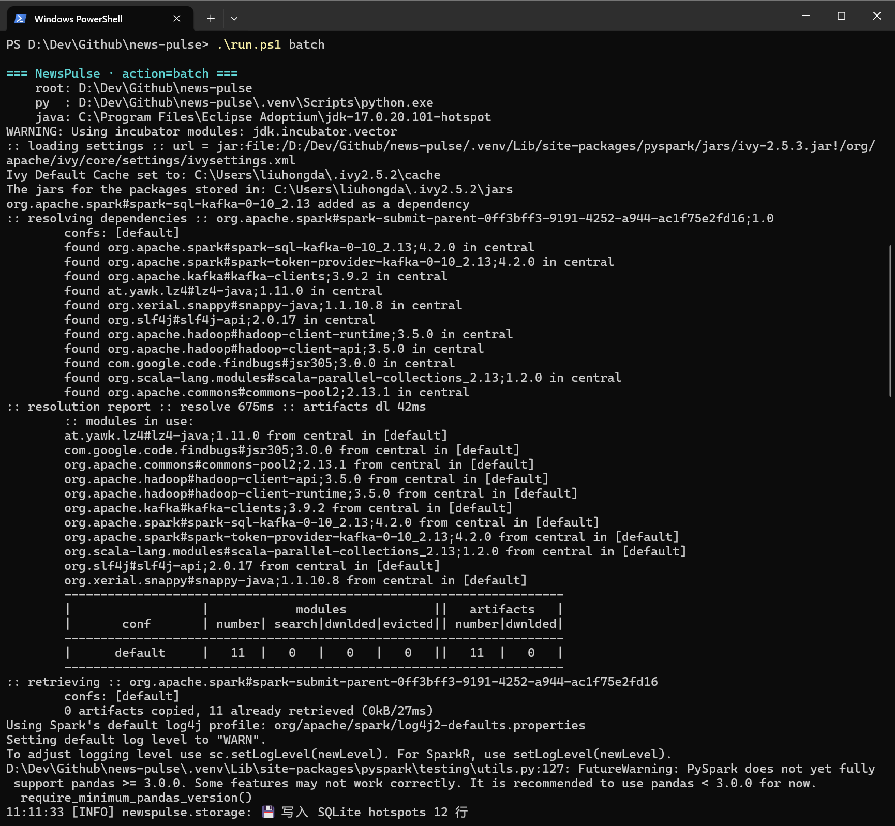

*图 5-7a：Spark SQL 批处理执行*

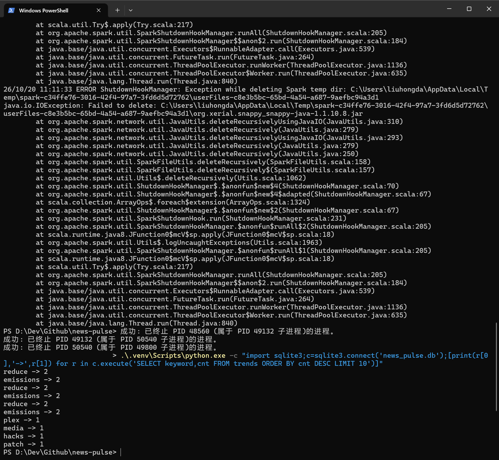

*图 5-7b：SQLite 中的热点与关键词结果*

### 5.8 可视化看板

看板访问 `http://localhost:8501`，四区块均正常渲染：

- KPI：新闻总量 25 / AI 已分析 12 / 活跃来源 5 / 热点关键词 285 / 负面舆情 6
- 新闻量趋势：面积图，X 轴为时间窗口
- 情感分布：环形图，负面 50% / 中性 33.3% / 正面 16.7%
- 来源分布：5 个源各 5 条
- 关键词：12 个实义词横向条形图
- 热点 Top10 与新闻卡片列表

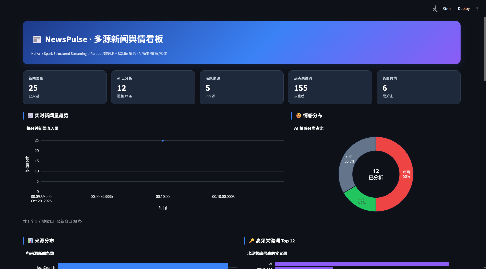

*图 8-1：看板界面（一）*

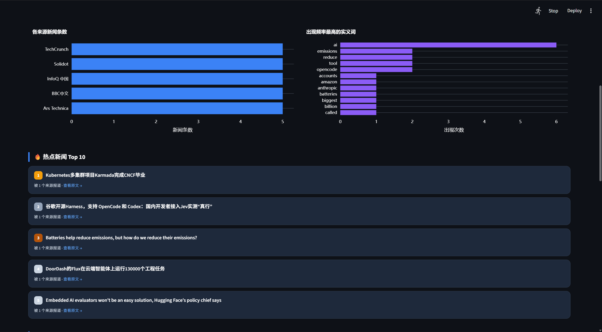

*图 8-2：看板界面（二）*

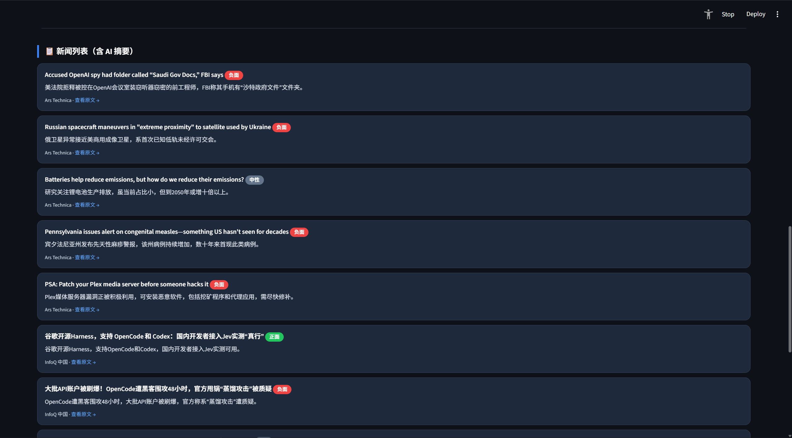

*图 8-3：看板界面（三）*

---

## 六、遇到的问题与解决方法

> 本节记录实机部署中真实遇到并解决的问题，全部有代码对应处理。

### 6.1 `SPARK_HOME` 环境变量残留导致 PySpark 无法启动

**现象**：`import pyspark` 正常，但创建 SparkSession 时报 `FileNotFoundError: [WinError 2] 系统找不到指定的文件`。

**排查**：打印 `_find_spark_home()` 结果，发现返回 `C:\spark`——一个此前安装过又删除的磁盘路径。系统级环境变量 `SPARK_HOME` 仍指向它，而 PySpark 3.5+ 会优先采信该变量而非自动探测 venv 内位置。

**解决**：在 `storage/spark_env.py` 中强制覆盖：

```python
spark_home = os.path.dirname(os.path.abspath(pyspark.__file__))
if os.environ.get("SPARK_HOME") != spark_home:
    os.environ["SPARK_HOME"] = spark_home
```

### 6.2 Windows 缺少 `winutils.exe` 导致写 Parquet 失败

**现象**：流处理启动后报 `HADOOP_HOME and hadoop.home.dir are unset`，或 `UnsatisfiedLinkError: NativeIO$Windows.access0`。

**原因**：Spark 在 Windows 上做文件系统操作（写 Parquet、checkpoint、权限检查）需要 Hadoop 原生二进制。

**解决**：下载 winutils（Hadoop 3.0.0 版本，与 Spark 4.2 内置的 3.5.0 兼容）放到 `infra/hadoop/bin/`，并在 `spark_env.py` 中自动设置 `HADOOP_HOME` 与 `PATH`。

### 6.3 Kafka connector 版本与 Spark 不匹配

**现象**：Kafka 能连接，但一处理数据就报 `NoSuchMethodError: SerializedOffset.<init>`。

**原因**：`spark.jars.packages` 写的是 `spark-sql-kafka-0-10_2.13:4.0.0`，而实际 Spark 是 4.2.0，Scala 2.13。connector 必须与 Spark **完全同版本**。

**解决**：改为 `4.2.0`，与 `spark-sql_2.13-4.2.0.jar` 对齐。

### 6.4 Parquet sink 不支持 `complete` / `update` 输出模式

**现象**：聚合结果要落盘时，报 `Invalid streaming output mode: complete. This output mode is not supported in Data Source parquet`。改用 `update` 同样报错。

**原因**：Parquet sink 仅支持 `append`（它无法表达"覆盖"语义）。

**解决**：改用 `foreachBatch`，在微批回调里把流 DataFrame 当静态 DataFrame 写入：

```python
.foreachBatch(lambda df, eid: df.write.mode("append").parquet(path))
```

### 6.5 真实 RSS 时间格式解析失败

这个问题分两步才解决，都是只在真实数据下才暴露：

**第一层**：RSS 用 RFC-2822 格式（`Mon, 19 Oct 2026 23:39:38 +0000`），直接 `to_timestamp` 报 `CAST_INVALID_INPUT`。

**第二层**：改用 `to_timestamp(col, "EEE, dd MMM yyyy HH:mm:ss Z")` 后报 `Illegal pattern character found in datetime pattern: E`——Spark 的 datetime pattern **不支持星期名 `EEE`**。

**第三层**：剥掉前缀后，我方 producer 产生的 ISO8601 带微秒时区格式（`2026-10-20T00:07:09.165523+00:00`）又无法解析。

**最终解决**：多格式 `coalesce` + 关闭 ANSI 严格模式（让脏时间戳返回 NULL 而非抛异常，一条脏数据不应挂掉整条流）：

```python
.config("spark.sql.ansi.enabled", "false")
```

### 6.6 Streamlit 切换主题后配色错乱

**现象**：深色模式下图表标题看不清；改完深浅色后，切换到另一主题又看不清，必须硬刷新。

**原因**（两层）：

1. 图表标题色被硬编码为深色 `#0f172a`，深色背景上不可见
2. Streamlit 切换主题**只改前端 DOM，不重跑 Python 脚本**——`_is_dark()` 读到的仍是旧值，注入的仍是旧配色

**解决**：

- 颜色按 `_is_dark()` 检测结果动态设置（深色用纯白，对比度约 19.8:1）
- CSS 变量**两种主题都注入**（若只在深色注入，切回浅色时旧的 `--np-text:#ffffff` 会残留，造成白底白字）
- 注入 JS 监听主题变化并自动 `reload`

附带发现并修复：来源分布图用 `marker.color = Series` + `colorscale`，Streamlit 渲染时把 Series 误判为单个颜色值，回退成**黑色**（控制台刷 `Invalid color specifier: number 5`），改为固定蓝色。

### 6.7 关键词榜被停用词占据

**现象**：关键词 Top12 全是 `says` / `are` / `in` / `for` / `on` / `be` / `yet`，毫无信息量。

**解决**：新建 `producer/stopwords.py`（约 340 个中英文虚词 + 纯数字过滤），在两层生效：

- `streaming`：用 `col("word").isin(stop_list)` 把过滤下推到 Spark，避免在流里跑 Python UDF
- `dashboard`：Pandas 侧再过滤一次，兼容已有的脏数据

修复后 Top12 变为 `ai` / `opencode` / `tool` / `reduce` / `emissions` / `batteries` 等实义词。

### 6.8 PowerShell 脚本的三个坑

**（a）`switch` 分支内不能声明 `param()`**

```powershell
"replay" {
    param([double]$Rate = 5)    # 非法，运行时报 "param 不是命令"
}
```

改为复用顶层参数。**注意**：PowerShell 的 AST 解析器不会报这个错，只在执行时才暴露。

**（b）文件缺 UTF-8 BOM 导致中文乱码**

PowerShell 5.1 在中文系统上按 GBK 读取无 BOM 文件，中文变乱码（`澶嶅埗`），进而导致字符串引号配对错乱、语法崩溃。解决：文件保存为 **UTF-8 with BOM**。

**（c）多个 `-D` 参数被拼成一个字符串**

```powershell
$KLG = "-Dlog4j... -Dkafka.logs.dir=..."   # 被当成一个参数传给 java
& $JAVA $KLG ...                            # java 报"读不到配置文件"
```

改为数组 + splatting：`$KLG = @("-D...", "-D...")` + `& $JAVA @KLG`。

### 6.9 JDK 版本探测选错

**现象**：本机同时装了 JDK 8 与 JDK 17，脚本却选用了 JDK 8。

**原因**：系统级环境变量 `JAVA_HOME` 指向 JDK 8（其他软件设置），而原逻辑"环境变量优先"。

**解决**：调整优先级为「配置文件指定 → 自动扫描(17 优先) → 环境变量」，并修正版本号解析——Java 8 的版本串是 `1.8.0_472`，需识别为 8 而非 1。

---

## 七、总结与展望

### 7.1 完成情况

对照作业七项要求：

| # | 模块 | 状态 | 说明 |
|---|---|---|---|
| 1 | 数据采集 | ✅ 完整 | RSS 真实采集 + JSONL 数据重放双通道 |
| 2 | 消息队列 | ✅ 完整 | Kafka 3.9 KRaft，topic `news.raw` 3 分区 |
| 3 | 流处理 | ✅ 完整 | 清洗 / 去重 / 三项实时聚合 / 写入数据湖 |
| 4 | 存储层 | 🟡 部分 | Parquet 数据湖 ✅ + SQLite ✅，**未使用 MinIO** |
| 5 | 批处理分析 | ✅ 完整 | Spark SQL 热点识别 + 关键词趋势 |
| 6 | AI 智能应用 | ✅ 完整 | 摘要 / 情感 / 实体 + 缓存 / 批量 / 重试 |
| 7 | 可视化看板 | ✅ 完整 | Streamlit 四区块，5 秒轮询刷新 |

**关于第 4 项的说明**：作业原文为"使用 MinIO 作为对象存储，配合 Delta Lake 或 Parquet 格式存储"。本项目采用本地 Parquet，原因有二：一是 Parquet 是作业明确认可的格式，且为 Delta Lake 的底层存储格式；二是本机为 Windows 家庭版，无 Hyper-V，无法运行 Docker，而 MinIO 不提供 Windows 原生二进制。迁移路径已预留——`storage/sink.py` 已封装存储访问，改用 MinIO 只需将路径前缀换成 `s3a://` 并配置 Hadoop AWS connector，业务代码无需改动。

### 7.2 收获

**技术层面**，掌握了三个关键认知：

1. **流处理与外部服务的解耦**。把 LLM 调用放进流里看似自然，但会因外部 API 的延迟与限流反过来阻塞数据管道。旁路批处理是更稳健的架构。
2. **有状态流处理的实际语义**。`watermark` + `dropDuplicates` 的配合，以及 `complete`/`update`/`append` 三种输出模式对不同 sink 的约束，只有动手跑过才有体感。
3. **Windows 下的 Spark 部署成本远高于 Linux**。`SPARK_HOME`、`winutils`、路径分隔符、JDK 版本等问题都需逐一处理，这也是生产环境普遍使用 Linux 容器的原因之一。

**工程层面**，认识到"能跑通"与"能交付"之间的差距。项目最终不仅实现了功能，还补充了环境自检（`run.ps1 check`）、配置模板、`.gitignore` 保护敏感信息、以及 9 项踩坑记录——这些是他人能复现项目的前提。

### 7.3 展望

若继续演进，优先级从高到低：

1. **接入 MinIO / Delta Lake**。获得 ACID 事务、时间旅行与并发写能力，同时让存储层与计算层真正分离。
2. **AI 分析流式化**。当前 AI 是旁路批处理，存在延迟。可改为用消息队列的独立 consumer 消费 `ai.pending` topic，与流处理并行，兼顾解耦与实时性。
3. **情感分析细粒度化**。当前只做三分类，可扩展为情感强度（1-5 分）与多主体情感（同一新闻对不同实体的不同态度）。
4. **看板实时推送**。当前 5 秒轮询，可改用 WebSocket 实现真正推送，降低无效查询。
5. **多主题动态配置**。`config.yaml` 已支持多源配置，可扩展为多主题（科技/财经/体育）分别产出看板与订阅。
6. **补充单元测试**。核心的正则解析（时间格式、停用词、窗口时间单位推断）行为完全确定，最适合写测试固化，避免后续改动引入回归。

### 7.4 遗留问题

如实记录两点：

- **趋势图数据点偏少**。当前 25 条新闻集中在同一分钟窗口内，趋势图只有 1 个数据点。这是演示数据密度问题，非功能缺陷。跨分钟分批发送即可产生多点曲线。
- **AI 分析覆盖不全**。25 条中仅 12 条做了 AI 富化（受 API 调用预算限制）。`ai.batch_runner` 支持 `--limit` 参数，全量分析只需多次执行，缓存会保证已分析部分不重复计费。

---

## 附录：项目结构

```
news-pulse/
├── producer/           # 数据采集
│   ├── schemas.py          NewsEvent 数据模型
│   ├── html_text.py        HTML → 纯文本
│   ├── rss_fetcher.py      RSS 并发采集（按域名限流）
│   ├── replay.py           数据集重放 + 模拟数据生成
│   ├── kafka_producer.py   Kafka 发送（失败重试）
│   ├── stopwords.py        中英文停用词表
│   └── run.py              CLI 入口
├── streaming/
│   └── spark_consumer.py   Structured Streaming 五段流水线
├── batch/
│   └── hotspot_job.py      Spark SQL 热点与趋势分析
├── ai/
│   ├── client.py           OpenAI 兼容客户端 + 重试
│   ├── cache.py            磁盘缓存
│   ├── tasks.py            摘要/情感/实体
│   └── batch_runner.py     批量执行
├── storage/
│   ├── sink.py             Parquet + SQLite 写入
│   └── spark_env.py        Spark 环境自检（Windows 适配）
├── dashboard/
│   └── app.py              Streamlit 看板
├── config/
│   └── kraft/server.properties
├── infra/
│   ├── kafka/              Kafka 3.9.0
│   └── hadoop/bin/         winutils.exe
├── data/
│   ├── lake/               Parquet 数据湖
│   ├── sample/             模拟数据集
│   ├── cache/              AI 缓存
│   └── checkpoints/        Spark checkpoint
├── run.ps1                 一键启动（10 个命令）
├── config.yaml             业务配置
├── config.local.example.ps1 个人配置模板
├── requirements.txt
└── README.md               详细说明（含完整踩坑记录）
```

代码统计：Python 17 个文件 2101 行；`run.ps1` 317 行。
